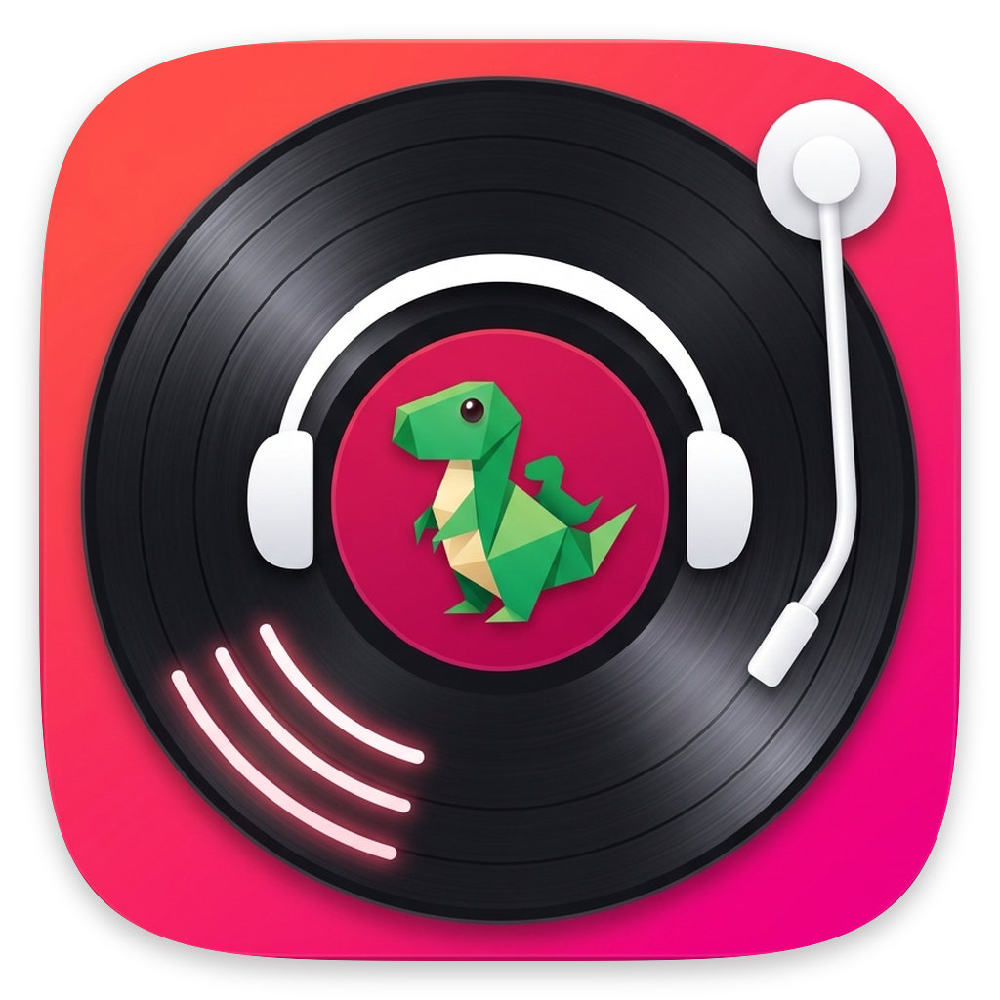

# 迷一会儿 · Miyo



由 **kiocou** 维护的双音源第三方桌面音乐客户端，完整支持**网易云音乐**与**咪咕音乐**，基于 [Cloudy](https://github.com/nya-owo/cloudy) / [egoist/mygo-cloudmusic](https://github.com/egoist/mygo-cloudmusic) 衍生修改。使用 Go 与 MyGo 原生 GUI 构建，无需 WebView，启动快、内存占用低。

## 特色功能

### 双音源完整兼容
- **网易云音乐 & 咪咕音乐自由切换**：推荐歌单、每日推荐、风格推荐、排行榜、私人 FM / 场景电台、搜索、歌手、专辑、歌单管理、评论区与红心计数全面适配。
- **动态音质实时切换**：底部播放栏与播放页自动读取当前音源及曲目实际支持的高解析度音质档位（如至臻母带 / 32-bit / 24-bit / 3D 环绕 / 无损 SQ / HQ），即时无感切换。
- **网易云无版权自动咪咕换源**：可开启自动换源兜底与双源聚合搜索。
- **双端独立登录体系**：支持网易云扫码 / Cookie 登录与咪咕扫码 / 浏览器 / Cookie 登录，个人喜欢歌单、收藏歌单、最近播放分别独立同步，凭据仅加密存放在本机。

### 液态玻璃与动效细节
- **液态玻璃界面**：胶囊播放栏、菜单、设置和弹窗均采用实时背景折射模糊，支持自定义透明度、模糊与背景色。
- **丝滑过场动画**：开屏唱臂抬起飞碟动效、播放页渐变展开、封面共享元素飞入、迷你窗口与桌面歌词呼出过渡。
- **逐字歌词与「律动」**：支持逐字时间戳、双语翻译、「律动」特效与桌面悬浮歌词。
- **音频引擎**：10 段均衡器与多种调音预设、音量均衡、无缝切换与淡入淡出、断点续播与缓存管理。

### Windows 桌面深度集成
- 任务栏缩略图控制按钮（上一首、播放/暂停、下一首、喜欢）与任务栏播放进度指示。
- 系统托盘独立原生玻璃弹层、全局快捷键录制、本地音乐文件夹扫描与文件关联打开。

## 下载

前往 [Releases](https://github.com/kiocou/miyo/releases) 下载 Windows 安装包（支持 x64 与 ARM64）。

## 构建

需要 Go 1.27+：

```bash
go tool mygo dev     # 开发模式运行
go tool mygo build   # 打包到 build/
go test ./internal/... # 运行测试
```

## 开源致谢

- [Cloudy](https://github.com/nya-owo/cloudy) / [egoist/mygo-cloudmusic](https://github.com/egoist/mygo-cloudmusic)：本项目基于该 AGPL-3.0 开源项目修改与扩展
- [Lucide](https://lucide.dev)：部分界面图标（ISC 许可）
- [MyGo](https://github.com/egoist/mygo)：原生 GPU 界面框架
- [sherpa-onnx](https://github.com/k2-fsa/sherpa-onnx)、[Qwen3-ASR](https://github.com/QwenLM/Qwen3-ASR) 与 [Silero VAD](https://github.com/snakers4/silero-vad)：本机播客语音字幕

本项目与网易云音乐及咪咕音乐官方无关，所有音乐与视听版权均归各权利人所有。

## 许可证

[AGPL-3.0](LICENSE)
